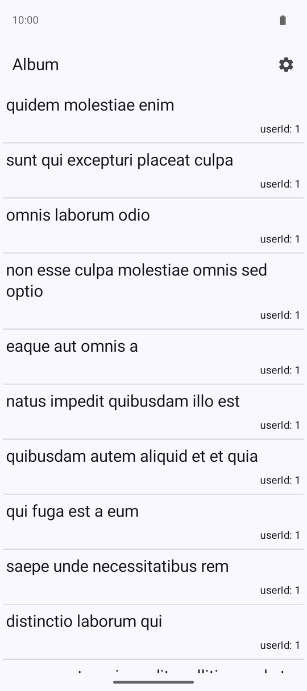
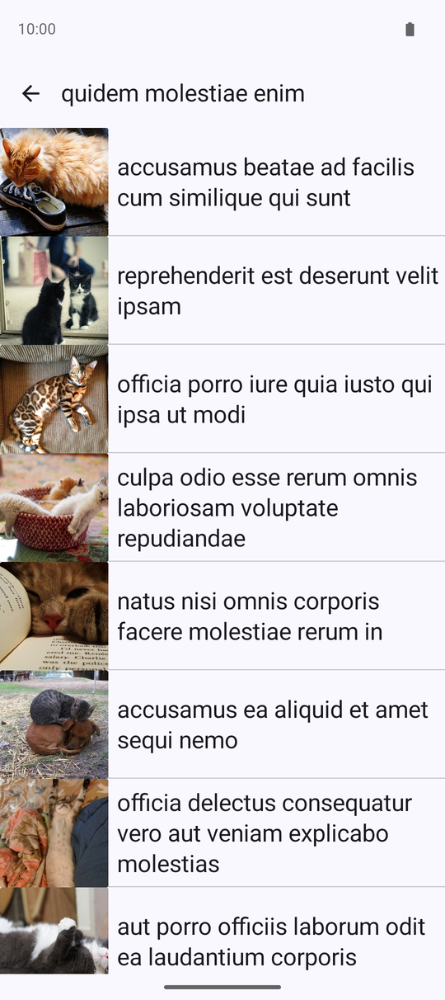
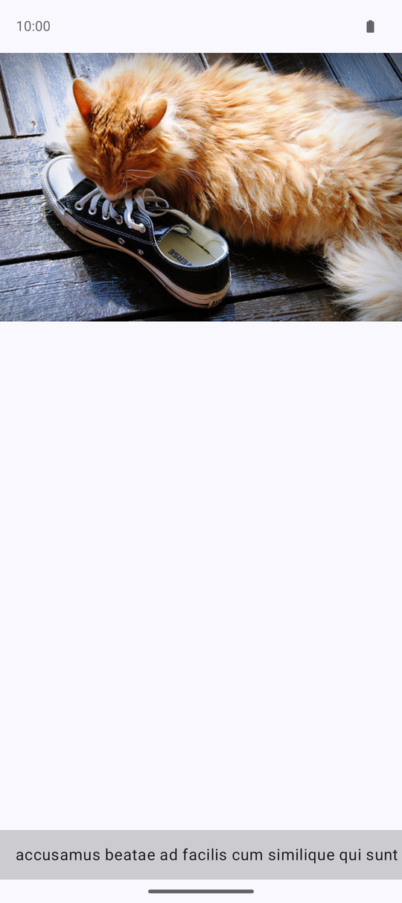
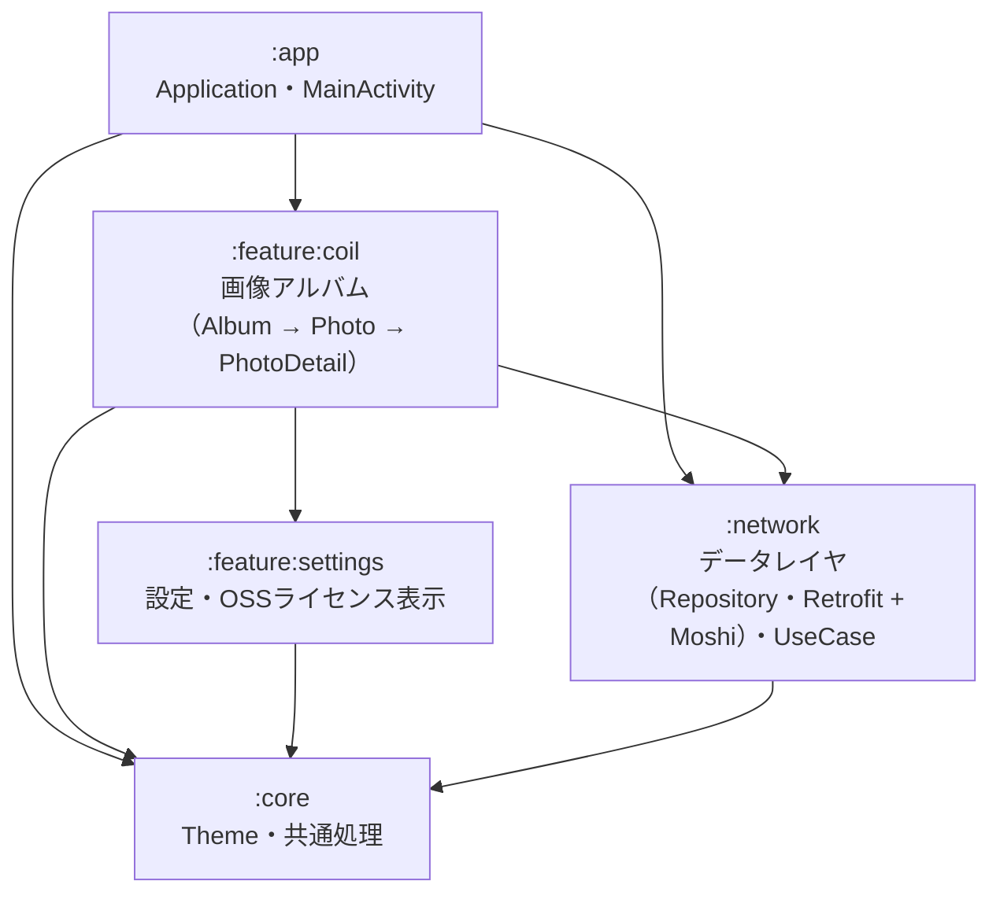
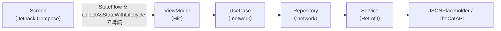

[](https://github.com/NaCl5alt/sampleAndroidApps/actions/workflows/unitTest.yaml)

# 📌 このアプリの目的
Androidの主要技術を実践的に学びながら、再利用・拡張がしやすいモジュール設計を試すための技術検証用サンプルアプリです。
自分だけでなく他者にも参考にしてもらえるようなアプリとなっていれば嬉しいです。

# 🏗️ 機能一覧
このアプリは複数の技術検証を目的とした「ミニアプリ集」として構成されており、現在は以下の機能を実装：
- Retrofit + Moshi + Coilを使った画像アルバム表示機能

| アルバム一覧 | 写真一覧 | 写真詳細 |
|:---:|:---:|:---:|
|  |  |  |

# ⚙️ 技術スタック
## 使用技術
- **DI**：Hilt
- **UI**：Jetpack Compose, zoomable
- **画像/ネットワーク**：Retrofit + Moshi, Coil3
- **画面遷移**：Jetpack Navigation3
- **ライセンス管理**：OSS Licenses Plugin
- **ログ**：Timber
- **テスト**：JUnit4, kotlinx-coroutines-test, MockWebServer（モックライブラリは使わず、フェイクで差し替え）

## アーキテクチャ構成
### モジュール構成
矢印は依存の向き（依存する側 → 依存される側）です。



### 画面からAPIまでの流れ（MVVM）


### Android 公式のアーキテクチャの推奨事項との対応
[Android アーキテクチャに関する推奨事項](https://developer.android.com/topic/architecture/recommendations?hl=ja)のうち、主に次の項目に沿っています。

| 推奨事項 | このリポジトリでの対応 |
|:---|:---|
| データレイヤのデータは Repository で公開する（強く推奨） | `AlbumRepository` などのインターフェースを公開し、Retrofit の呼び出しは `:network` の中の実装クラスに閉じる |
| ライフサイクルを考慮して UI の状態を収集する（強く推奨） | 画面は ViewModel の StateFlow を `collectAsStateWithLifecycle()` で購読する |
| 単一 Activity のアプリにする（強く推奨） | 画面遷移は Navigation 3 の `NavDisplay` にまとめ、設定画面も同じ Activity の中の画面にする（OSS ライセンスの一覧だけはライブラリの Activity） |
| 単方向データフロー・画面単位の ViewModel（強く推奨） | ViewModel が UiState を StateFlow で公開し、画面は描画と操作の通知だけを行う |
| 依存関係の注入（強く推奨）・Hilt（推奨） | Hilt で注入する。IO 用の Dispatcher も注入し、テストでは TestDispatcher に差し替える |
| モックよりフェイクを使う（強く推奨） | ViewModel と UseCase のテストは、フェイクの Repository で組み立てる |

## 開発方針
- なるべくシンプルで応用が想像しやすいようなミニマルな機能を持つミニアプリを複数内包したアプリであること
- 複数内包したアプリは個別のアプリ化が行うことが可能であること

# 🗂️ プロジェクト構成
- ディレクトリ構成の簡易図（`/ui`, `/domain`, `/data`, `/di` など）
	- /app
		- ベースとなるApplicationやActivityを配置
		- 依存モジュール
			- :core
			- :network
			- :feature:coil
	- /core
		- /ui/theme
			- アプリ全体で利用できるJetpack Compose用のThemeを配置
		- /util
			- アプリ全体で利用できる汎用的なクラスや関数を配置
		- 依存モジュール
			- なし
	- /feature
		- ミニアプリ毎にディレクトリを作成し、UIを実装
			- /coil
				- Retrofit + Moshi + Coilを使った画像アルバム表示機能
				- 依存モジュール
					- :core
					- :network
					- :feature:settings
			- /settings
				- OSSライセンスの表記を行う画面への遷移を行うための設定画面機能（`:feature:coil` の Navigation 3 から1つの画面として表示）
				- 依存モジュール
					- :core
	- /network
		- ホスト毎にディレクトリを作成し、Retrofit の Service（データソース）、それを包む Repository（データレイヤの入口）、Repository を使う UseCase を配置
			- UseCaseは本来、/feature内の該当するミニアプリのディレクトリ内部に配置するのが良いと思うが、現時点ではUseCase内の処理がミニアプリに固有の処理が含まれていないため、こちらに配置
		- 依存モジュール
			- :core

# 🧠 設計思想
## 設計意図
- コードが肥大化せず、単機能に集中できる構成を目指す
- 実務でも想定される複数画面、複数APIの実装に備えたスケーラブルな構造を採用
## 工夫している点
- マルチモジュール化により、ビルド高速化と責務分離を実施。
- 特に`feature`配下のモジュールをミニアプリ単位で独立させることで、以下の効果を期待：
	- 機能追加・削除の影響範囲を局所化
	- 特定機能のみの再利用や再ビルドが容易

# 🧪 環境構築ガイド
- Android Studioのバージョン
	- `Android Studio Narwhal | 2025.1.1 Build #AI-251.25410.109.2511.13665796, built on June 19, 2025`で動作確認済み
- JDKバージョン：17 （Android Studio Narwhal に付属のものを使用）
- `.env` や APIキーの有無（あれば記載）
	- 現状はなし
	- リリースビルドができるようにしたら、.envファイルが必要となる予定
- ビルド手順
```bash
git clone https://github.com/NaCl5alt/sampleAndroidApps.git
cd sampleAndroidApps
./gradlew clean assembleDebug
```
- ビルド時の注意点
	- 現状はなし
	- ミニアプリが複数になり、ミニアプリ別にアプリ化ができるようになったら必要になる予定

# ✅ テスト
ViewModel・UseCase・Repository・共通処理にユニットテストを用意しています。GitHub Actions でコードを push するたびに実行しています。

| 対象 | 確認していること | 使っているもの |
|:---|:---|:---|
| ViewModel（`:feature:coil`） | UseCase の結果が UiState に反映されるか、失敗したときの振る舞い | フェイクの Repository, kotlinx-coroutines-test |
| UseCase（`:network`） | 猫の画像の一覧から1件目の URL を取り出す処理と、失敗の伝え方 | フェイクの Repository |
| Repository（`:network`） | リクエストのパス、JSON のパース、HTTP エラーのときに失敗を返すか | MockWebServer |
| 共通処理（`:core`） | Retrofit の Response を Result に変換する処理（通信の失敗も例外にせず Result で返す）、空のボディを null にする Converter | JUnit4 |

- ViewModel のテストは、本物の UseCase にフェイクの Repository を渡して組み立てています（モックライブラリは使っていません）
- ViewModel には IO 用の Dispatcher を Hilt で注入しているので、テストでは TestDispatcher に差し替えて非同期処理を順番どおりに検証しています
- Repository のテストは MockWebServer に本番と同じ Converter で接続し、API の呼び方とパースまで確認しています

```bash
./gradlew testDebugUnitTest
```

# 🚧 今後の予定
- 実装予定の機能
	- MPAndroidChartチャートミニアプリ
	- WebSocketチャットミニアプリ
	- GPS+Google Map APIを用いたマップミニアプリ
	- Bluetoothを用いたアプリ
	- USBを用いたアプリ
- リファクタ予定や改善したい点
	- マルチディメンジョンによるマルチアプリ化
	- GitHub ActionsでのktlintとDangerによるPRレビュー

# 🗒️ 補足
- 参考にしたリポジトリや記事
	- [android/nowinandroid](https://github.com/android/nowinandroid/tree/main)
	- [DroidKaigi/conference-app-2023](https://github.com/DroidKaigi/conference-app-2023)
- 開発中に気づいたこと・工夫した点
	- ミニアプリ毎にモジュール分割をすることによって、将来的に個別にアプリ化が行いやすくするようにしました
	- 最新のJetpack Navigation3を用いて画面遷移処理を実装しました（設定画面も含めて、1つの Activity の中で遷移します）

# 📚 ライセンス
このリポジトリは MIT ライセンスのもとで公開されており、商用利用・改変・再配布を自由に許可しています。
詳細は [LICENSE](./LICENSE) ファイルを参照してください。

##### 使用ライブラリのライセンスについて
本アプリで使用しているOSSライブラリのライセンスは、設定画面内で確認できます（[play-services-plugins/oss-licenses-plugin](https://github.com/google/play-services-plugins/tree/main/oss-licenses-plugin)を使用）。
